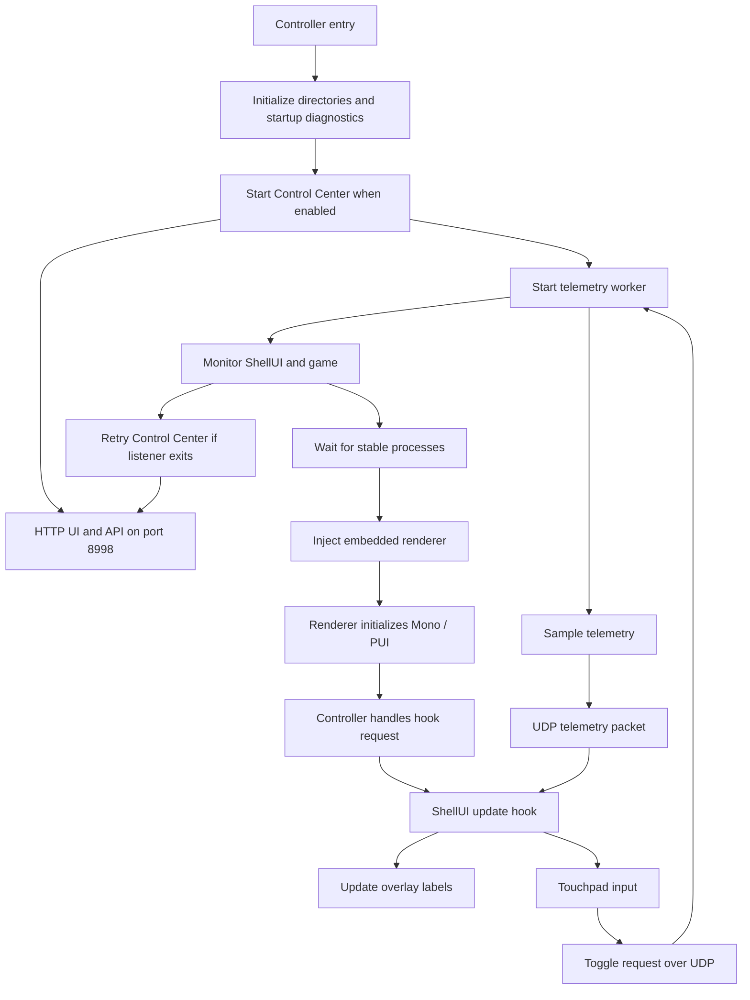

# PrefBar 0.3.1: how it works

This document describes the implementation present in the repository. It is not a feature roadmap and does not claim that every firmware path has been tested.

## Build model

The repository has one CMake entry point: the root `CMakeLists.txt`. There is no separate PS5 CMake project.

The PS5 Payload SDK supplies the cross-compilation toolchain and PS5 headers/libraries. The project-specific compatibility sources are bundled under `src/ps5/compat/`; the build does not clone separate Common FPS, shsrv, or etaHEN source trees. Some bundled source remains derived from those projects. See [CREDITS.md](CREDITS.md) and the original notices in the source files.

### Build targets

The PS5 CMake configuration defines two targets:

1. `prefbar_shellui` builds `PrefBar_ShellUI_v0.3.1.elf`, the renderer image.
2. `prefbar_controller` builds `PrefBar_controller_v0.3.1.elf`, the controller payload.

`scripts/tools/embed_binary.py` converts the renderer ELF into a generated C++ byte array under `build-ps5/generated/`. That generated source is linked into the controller.

When `PREFBAR_ENABLE_WEB=ON` (the default), the same helper embeds `web/index.html` as a second generated byte array, and `web/backend/web_server.cpp` is linked into the controller. Set `PREFBAR_ENABLE_WEB=OFF` to omit both the web asset and HTTP server; the controller build then excludes the web-specific startup and retry code as well.

`scripts/tools/verify_release.py` performs static checks on the intermediate artifacts. The build script stages one combined payload:

```text
dist/Prefbar_V0.3.1.elf
```

The renderer ELF and controller ELF under `build-ps5/` are intermediate build outputs, not separate files that users need to load.

### Host checks

Host tests are optional and do not produce a PS5 payload:

```sh
make test
```

The test sources are under `scripts/tests/`; test executables are created under `build-host/`. The seven host tests cover wire-format validation, diagnostics/configuration, telemetry-pool behavior, adaptive DCE counter selection, touchpad input, ShellUI hook-protocol handling, and crash-strike tracking. They do not compile or exercise the PS5-only Web Control Center backend; that still needs a PS5 SDK build and testing against the server on a console.

## Runtime architecture

### Runtime flow

The diagram below shows the startup order and how the Control Center, telemetry worker, and ShellUI renderer interact during runtime. The web server is optional and is started before telemetry when enabled.



### 1. Controller and lifecycle

`src/ps5/prefbar_controller.cpp` is the controller entry point. It creates `/data/prefbar` and records startup diagnostics, starts the Web Control Center first when web support is enabled, then starts the embedded telemetry worker and monitors the running PS5 processes. The controller retries a failed Control Center startup and watches the listener during runtime so it can restart it if the worker exits. With `PREFBAR_ENABLE_WEB=OFF`, these web startup and retry paths are compiled out.

The controller asks the system to name its main thread `PrefBar` using `SYS_thr_set_name` and records the return code and `errno`. This is a thread-name request; it does not rename the ELF file or guarantee that every process viewer will display the process as `PrefBar`.

The controller waits for stable process observations before starting the renderer. The current source uses a 50 ms polling interval, a 10-sample ShellUI stability gate, and a 3-sample game-process stability gate. Renderer startup is deferred until both ShellUI and a game process have been observed as stable.

### 2. Telemetry worker

`src/ps5/telemetry/prefbar_telemetry.c` runs as a thread inside the controller payload. It samples the display flip counter through `/dev/dce` when a game process is ready, maintains frame statistics, queries optional system telemetry APIs, writes status/diagnostic files, and sends overlay rows to the renderer.

The telemetry worker does not read or write game-process memory. The DCE counter is used as the source for frame statistics and is normally read from the 64-bit field at offset 0x08 of the DCE reply. On older firmware, that field may remain unchanged even when the ioctl succeeds; while it has not advanced in the current game, the worker looks for another field that rises at a steady, plausible frame rate (10 to 250 per second, within 12 FPS across two half-second windows). The fallback is dropped after three windows without movement, and offset 0x08 takes priority again as soon as it advances. Common FPS for PS5 reported a counter at offset 0x10 on firmware 4.51; this adaptive fallback addresses the older-firmware reports in issue #17. Field changes are logged as `dce.counter` in `debug.log`. Sensor APIs are optional/weakly linked, so a metric can be unavailable on a particular firmware or runtime environment.

Disabled metrics and unavailable readings are compacted, so later enabled metrics move into the next available row instead of leaving blank gaps. If SoC sensor channel 2 is exposed but returns no valid M.2 reading, the enabled M.2 row displays N/A. Each FPS, frametime, 1% low, CPU usage, CPU temperature, CPU clock, GPU temperature (SoC sensor 0), GPU clock, fan duty, RAM, VRAM, power, and M.2 temperature metric has its own switch. This compacted sequence is shared by vertical and horizontal layouts. When all metrics are disabled or unavailable, PrefBar sends an empty row to clear previously displayed text.

The current overlay can show thirteen independently selectable metrics:

- FPS, average frametime, and 1% low.
- CPU utilization, CPU temperature, and CPU clock.
- GPU temperature (read from SoC sensor 0) and GPU clock.
- Fan duty as a percentage.
- RAM and VRAM readings.
- SoC APU power consumption in watts when the kernel API is available.
- M.2 NVMe expansion-drive temperature from SoC sensor channel 2, when exposed by the console.

PrefBar displays this reading as **GPU temperature** by default because that is the familiar, user-friendly label used by existing overlays and tools. The value is obtained from `sceKernelGetSocSensorTemperature(0, ...)`. The API name identifies a SoC sensor, but the PrefBar team has not independently verified the exact physical sensor location or confirmed that it represents the GPU die, edge, or hotspot. We therefore document both facts separately: **GPU temperature** is the default display label; **SoC sensor 0** is the verified API source. The label is configurable without changing the sampled value: set `gpu_temp_label=soc` to restore the previous SoC wording. The key/value status file exports both `gpu_temp_c` (user-facing name) and `soc_temp_c` (source-oriented name); both contain the same sensor reading, not two separate measurements. It also exports `m2_temp_available`, `m2_temp_api_present`, `m2_temp_rc`, and, when available, `m2_temp_c` for the M.2 expansion drive.

The M.2 temperature metric reads `sceKernelGetSocSensorTemperature(2, ...)`, the SoC sensor channel used by existing PS5 overlays for the M.2 NVMe expansion drive. Readings outside 20–130 °C or failed reads are treated as unavailable; when the channel exists but no usable drive reading is returned, the overlay displays `M.2 N/A` (or `SSD N/A` when the alternate label is selected). This is specifically the M.2 expansion slot, not the console internal storage or an external USB drive. The label can be changed with `m2_temp_label=ssd`; the default is `m2`.

The PWR metric uses the optional sceKernelGetSocPowerConsumption kernel API. Its raw milliwatt lanes are aggregated and converted to watts; if the API is unavailable or returns no valid sample, the row is omitted. Horizontal mode places the compacted metrics on one line. It estimates the complete bar width, then aligns it left, centered, or right. Font size is reduced only when needed to fit within the screen margins.

**Fan duty is not fan RPM.** The currently used fan API reports a Q10 duty value, converted to a percentage. The project does not claim that this API supplies tachometer RPM.

The telemetry worker writes human-readable `status.txt` and key/value `status.kv` files under `/data/prefbar`. It also appends debug events to `debug.log`; optional diagnostic captures are written to `diag.txt`.

### 3. Telemetry and control protocol

`include/prefbar/telemetry_wire.h` defines the C-compatible version-6 telemetry packet shared by the C telemetry worker and C++ renderer. The packet carries up to fifteen compacted text rows, font size, corner/position, text color, overlay visibility, text-shadow state, touchpad-toggle state, and horizontal layout. Horizontal spacing and alignment are encoded in the packet flags. The capacity accommodates thirteen independent metrics plus two optional diagnostic rows.

The controller sends telemetry to the renderer over UDP loopback on port `39028`. The renderer sends overlay-toggle events back to the controller over UDP loopback on port `39029`. These messages are local to the console; they are not sent over the network interface.

The hook/control request and acknowledgment structures are declared in `include/prefbar/shellui_hook_protocol.hpp`. The stage file path is declared in `include/prefbar/shellui_stage.hpp`.

### 4. ShellUI renderer

`src/ps5/shellui_payload/prefbar_shellui.cpp` is the renderer implementation and `prefbar_shellui_entry.cpp` provides its entry point. The renderer attaches to the ShellUI Mono runtime, uses the PUI UI classes to create text labels, receives telemetry packets, and updates the labels when the packet or visibility state changes.

The renderer is built as an intermediate ELF and embedded in the controller. Users therefore load the combined `Prefbar_V0.3.1.elf`, not a separate renderer ELF.

The renderer reads the DualSense touchpad-click state. Three distinct touchpad-click press edges within a 1.5-second window toggle the overlay. Hiding the overlay does not stop the telemetry worker.

The renderer contains more than one runtime path for integrating its drawing loop with ShellUI. The selected path depends on the runtime and hook compatibility checks. If initialization cannot establish a supported path, it fails closed rather than reporting the renderer as online.

The old controller artwork, embedded pad image, sprite creation, PNG writing, and controller-image overlay are not part of the current renderer. Touchpad input remains because it is the overlay visibility control.

## Runtime configuration

On first start, the telemetry worker creates this file if it does not already exist:

```text
/data/prefbar/prefbar.conf
```

It does not overwrite an existing file. On upgrade, PrefBar adds any missing options introduced by the new version while preserving existing entries and values. Migration preserves existing values and adds missing horizontal alignment, the new `overlay_format=compact` default, `text_opacity=100`, `background_enabled=1` and `background_opacity=70`, per-metric visibility settings, `gpu_temp_label=gpu` when the label option is absent, and the enabled-by-default M.2 temperature metric with `m2_temp_label=m2`. In older configurations, the new switches inherit the former grouped values: `show_fps` seeds FPS, frametime, and 1% low; `show_cpu` seeds CPU usage and CPU temperature; `show_soc_temp` seeds GPU-temperature visibility (`show_gpu_temp`, retained as the current compatibility key for the SoC sensor 0 reading); and `show_memory` seeds RAM and VRAM. Existing clock, fan, and power switches are preserved. New horizontal alignment defaults to `center`. The new metric format defaults to `compact`; existing configurations receive that setting during migration, while `overlay_format=classic` restores the previous one-metric-per-row presentation. The controller reloads the file once when a new game session is confirmed; there is no continuous polling. A failed read keeps the last successfully loaded settings until the next game session.

The parser reads simple `key=value` lines. Blank lines, comment lines beginning with `#` or `;`, and section labels such as `[overlay]` are ignored. Section labels are for readability only; keys are matched globally, not scoped to a section. Use each key once. Unknown keys and malformed/out-of-range values are ignored and the built-in default is used. Each reload reads one file snapshot, so settings from separate saves are not mixed.

All boolean values use `0` (off) or `1` (on).

| Setting | Meaning | Accepted values / default |
|---|---|---|
| `notifications` | Master system-toast switch | `0` or `1`; default `1` |
| `startup_notification` | Show the PrefBar attribution and Control Center startup-status toasts | `0` or `1`; default `1` |
| `error_notifications` | Allow error toasts | `0` or `1`; default `1` |
| `warning_notifications` | Allow warning toasts independently of other debug notifications; warnings are still written to `debug.log` when disabled | `0` or `1`; default `0` |
| `debug_notifications` | Allow non-error, non-warning debug/milestone toasts | `0` or `1`; default `0` |
| `debug_notify` | Maximum verbosity for regular event toasts: `0` off, `1` errors, `2` warnings, `3` information/milestones, `4` trace; startup toasts use `startup_notification` separately | `0`–`4`; default `1` |
| `notify_sec` | Periodic performance-toast interval; zero disables periodic toasts | `0`–`3600` seconds; default `0` |
| `overlay` | Show or hide the on-screen overlay | `0` or `1`; default `1` |
| `text_color` | Overlay text color | `#RRGGBB`; default `#F2F2F2` |
| `text_opacity` | Overlay text opacity; the text shadow remains controlled separately | `0`–`100` percent; default `100` |
| `background_enabled` | Show one shared black background panel behind the overlay rows | `0` or `1`; default `1` |
| `background_opacity` | Opacity of the shared black background panel; independent of text opacity | `0`–`100` percent; default `70` |
| `text_shadow` | Draw a text shadow | `0` or `1`; default `1` |
| `overlay_mode` | `0` compact layout, `1` extended diagnostic rows | `0` or `1`; default `0` |
| `overlay_font` | Text font size in pixels | `10`–`96`; default `26` |
| `overlay_corner` | Overlay anchor: `0` top-left, `1` top-right, `2` bottom-left, `3` bottom-right | `0`–`3`; default `0` |
| `overlay_x` | Horizontal margin in pixels | `0`–`1800`; default `24` |
| `overlay_y` | Vertical margin in pixels | `0`–`1000`; default `24` |
| `overlay_format` | Metric presentation: related metrics grouped into compact rows or one metric per row | `compact` or `classic`; default `compact` |
| `overlay_horizontal` | Render metric rows as one horizontal bar | `0` or `1`; default `0` |
| `overlay_horizontal_spacing` | Gap between metrics in horizontal mode | `short`, `medium`, or `long`; default `medium` |
| `overlay_horizontal_align` | Horizontal bar alignment | `left`, `center`, or `right`; default `center` |
| `sensors` | Enable optional sensor/CPU/memory sampling | `0` or `1`; default `1` |
| `show_fps` | Show FPS | `0` or `1`; default `1` |
| `show_frametime` | Show average frametime | `0` or `1`; default `1` |
| `show_1percent_low` | Show 1% low FPS | `0` or `1`; default `1` |
| `show_cpu_usage` | Show CPU utilization | `0` or `1`; default `1` |
| `show_cpu_temp` | Show CPU temperature | `0` or `1`; default `1` |
| `show_cpu_clock` | Show current CPU frequency in MHz | `0` or `1`; default `1` |
| `show_gpu_temp` | Show the GPU temperature reading from sensor 0 | `0` or `1`; default `1` |
| `gpu_temp_label` | Display label for the sensor 0 temperature reading | `gpu` or `soc`; default `gpu` |
| `show_gpu_clock` | Show current GPU GFXCLK in MHz | `0` or `1`; default `1` |
| `show_fan_duty` | Show fan-duty percentage | `0` or `1`; default `1` |
| `show_ram` | Show RAM usage | `0` or `1`; default `1` |
| `show_vram` | Show VRAM usage | `0` or `1`; default `1` |
| `show_power` | Show SoC APU power in watts when available | `0` or `1`; default `1` |
| `show_m2_temp` | Show M.2 NVMe expansion-drive temperature when the sensor channel is available | `0` or `1`; default `1` |
| `m2_temp_label` | Label the channel-2 expansion-drive temperature reading | `m2` or `ssd`; default `m2` |
| `touchpad_toggle` | Enable triple-click overlay visibility control | `0` or `1`; default `1` |
| `diag` | Enable diagnostic captures | `0` or `1`; default `0` in the embedded PS5 build |
| `poll_us` | Telemetry polling interval in microseconds | `500`–`20000`; default `2000` |

For vertical overlays, top-right and bottom-right align each populated row to the right screen margin. Horizontal bars continue to use `overlay_horizontal_align` for left, center, or right placement; `overlay_corner` selects their top or bottom edge.

Legacy keys `show_cpu`, `show_soc_temp`, and `show_memory` are read during migration to seed the new independent switches. `gpu_temp_label` is added as `gpu` to existing configurations that do not already define it. Set it to `soc` to use the previous SoC label.

Example configuration:

```ini
# PrefBar 0.3.1 configuration

[notifications]
notifications=1
startup_notification=1
error_notifications=1
warning_notifications=0
debug_notifications=0
debug_notify=1
notify_sec=0

[overlay]
overlay=1
text_color=#F2F2F2
text_opacity=100
background_enabled=1
background_opacity=70
text_shadow=1
overlay_mode=0
overlay_font=26
# 0 top-left, 1 top-right, 2 bottom-left, 3 bottom-right
overlay_corner=0
overlay_x=24
overlay_y=24
overlay_horizontal=0
overlay_horizontal_spacing=medium
overlay_format=compact
overlay_horizontal_align=center

[telemetry]
sensors=1
show_fps=1
show_frametime=1
show_1percent_low=1
show_cpu_usage=1
show_cpu_temp=1
show_cpu_clock=1
show_gpu_temp=1
gpu_temp_label=gpu
show_gpu_clock=1
show_fan_duty=1
show_ram=1
show_vram=1
show_power=1

[input]
touchpad_toggle=1

[diagnostics]
diag=0
poll_us=2000
```

Setting `overlay=0` hides the renderer output while telemetry and status-file updates continue. Setting `sensors=0` disables the optional sensor sampling; frame-counter sampling remains a separate path. Setting `touchpad_toggle=0` disables the touchpad gesture.

## Web Control Center

The existing interface is kept in `web/index.html` and embedded into the controller during the PS5 build. The build reuses `scripts/tools/embed_binary.py` with a separate C++ symbol for the web asset; no web files need to be installed on the console.

The controller starts the native HTTP server from `web/backend/web_server.cpp`. It listens on IPv4 port **8998** and serves only `/` and `/index.html` as the Control Center. It does not expose arbitrary filesystem paths or the backend source directory.

### API

| Method | Endpoint | Response |
|---|---|---|
| GET | `/api/v1/health` | Server and API version |
| GET | `/api/v1/config` | Current `prefbar.conf` as INI text |
| PUT | `/api/v1/config` | Validates and atomically replaces `prefbar.conf` |
| GET | `/api/v1/status` | Current `status.kv` telemetry snapshot |
| GET | `/api/v1/diagnostics` | Bounded snapshots of `boot.log`, `controller.log`, `debug.log`, and `diag.txt`; an oversized log is reported unavailable rather than truncated |

The Control Center loads the saved INI when opened. Its Save action sends the complete generated INI document using `PUT /api/v1/config`; when the page is hosted somewhere without the PrefBar API, the action falls back to downloading `prefbar.conf`. The server rejects duplicate, missing, unknown, malformed, and out-of-range settings. A successful write uses a temporary file, flushes it, and renames it over the existing configuration.

Saving does not force a live telemetry reload. The telemetry worker reads the new configuration when it confirms the next game session, matching the existing runtime configuration lifecycle.

### Network access

The server binds to all IPv4 interfaces and does not restrict client addresses or require authentication. Any device that can reach the PS5 on port 8998 can open the Control Center, read status/diagnostics, and change PrefBar settings. Keep this in mind when choosing the network the console is connected to.


## Diagnostics and hook-probe logs

The controller writes startup information to `/data/prefbar/controller.log` and timestamped startup checkpoints to `/data/prefbar/boot.log` (rotated to `boot.log.1` after it grows beyond 32 KiB). The injector writes `/data/prefbar/injector.log`. The renderer writes `/system_tmp/prefbar_shellui.log` and records its latest startup stage in `/system_tmp/prefbar_shellui.stage`. The Control Center diagnostics endpoint returns bounded snapshots of `boot.log`, `controller.log`, `debug.log`, and `diag.txt`; it does not expose the injector or renderer log paths.

The hook-probe diagnostic record distinguishes the wrapper return (`read_rc`), raw ptrace syscall result (`read_raw_rc`), whether the read was attempted, the captured `errno`, and the requested/reported I/O descriptor length. For a probe-only request, `write_attempted=0`; the default `write_rc=-1` is a sentinel and does not mean that a write failed.

For the ptrace-I/O path, `read_reported_len` is copied from `ptrace_io_desc.piod_len` after the syscall attempt. That field is initialized with the requested size and may remain unchanged if the operation fails, so a non-zero reported length alone does not prove that bytes were transferred. Interpret it together with `read_rc`, `read_raw_rc`, `read_attempted`, and `read_errno`. The MDBG path reports the requested size on success and zero on failure.

This instrumentation improves diagnosis; it is not itself a fix for firmware-specific probe failures. A successful static release check or host test does not establish that every firmware's ShellUI path works. Confirm with a PS5 SDK build and hardware test.

## Repository layout

| Path | Purpose |
|---|---|
| `CMakeLists.txt` | Single CMake entry point for host tests and PS5 targets |
| `Makefile` | Short commands for host tests, PS5 payload build, and cleanup |
| `include/prefbar/` | Shared telemetry, hook protocol, stage, and touchpad interfaces |
| `src/ps5/prefbar_controller.cpp` | Controller lifecycle and startup |
| `src/ps5/telemetry/` | Telemetry sampling, configuration, status and diagnostic output |
| `src/ps5/shellui_payload/` | Embedded ShellUI renderer |
| `src/ps5/compat/` | Bundled compatibility sources, including ptrace and ELF-loader code |
| `scripts/scripts/` | PS5 build entry-point script |
| `scripts/tools/` | Renderer/Web Control Center asset embedding and release verification helpers |
| `scripts/tests/` | Host-side self-tests |
| `web/index.html` | Embedded Web Control Center interface |
| `web/backend/` | Native HTTP server and Control Center API |
| `Docs/` | Build, architecture, and provenance documentation |

## Provenance

PrefBar has its own controller organization, telemetry packet, telemetry worker integration, and current overlay data path. Some low-level PS5 integration, loader, and renderer code remains derived from earlier GPL-licensed projects. Bundling the required source means a separate checkout is not needed to build PrefBar; it does not make that code a clean-room rewrite.

In particular, `src/ps5/stable_elfldr_bridge.c` includes the bundled `src/ps5/compat/elfldr.c` implementation and uses its loader definitions/helper functions, including `elfldr_payload_args()`. The legacy ELF-loader source is therefore still present in the build; documentation should not describe it as removed. See [CREDITS.md](CREDITS.md) for project attribution and the retained file-level copyright/SPDX notices for source provenance.
