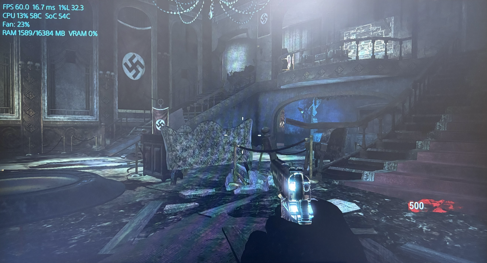

<p align="center">
  
</p>

[](https://github.com/X1NONs/PrefBar/releases)

**Version 0.2.1**

A standalone on-screen performance overlay for jailbroken PlayStation 5 consoles. PrefBar displays live performance and system telemetry directly over your games, without requiring a separate renderer payload.

## Why This Exists

The built-in performance bars available in some PS5 homebrew setups can conflict with other kernel-level components or payloads, such as kstuff and etaHEN. PrefBar was created as an independent alternative: a standalone payload with its own ShellUI renderer, designed to provide in-game telemetry without depending on another payload for rendering.



> Want yours to get displayed? Check out [Screenshot Discussion](https://github.com/X1NONs/PrefBar/discussions/13).

## Features

- **Frame performance:** FPS, average frametime, and 1% lows.
- **CPU/GPU telemetry:** CPU utilization, CPU frequency, GPU clock, CPU temperature, and GPU temperature when the relevant system interfaces are available.
- **Fan telemetry:** Fan-duty percentage. This is not an RPM reading.
- **Memory:** RAM and VRAM usage when the relevant system interfaces are available.
- **SoC power:** APU power consumption displayed in watts when the relevant kernel API is available.
- **Horizontal overlay:** Display all enabled metrics in one horizontal bar, centered by default, with configurable left/center/right alignment and short, medium, or long spacing.
- **Independent telemetry controls:** Enable or disable FPS, frametime, 1% low, CPU usage/temperature/clock, GPU temperature/clock, fan duty, RAM, VRAM, and SoC power separately. The GPU temperature label defaults to the familiar "GPU" wording; set `gpu_temp_label=soc` to use the previous SoC label.
- **Compact and classic metric formats:** Compact groups related metrics; classic preserves the previous one-metric-per-row layout. Disabled or unavailable metrics are omitted in either format.
- **Standalone payload:** The controller and ShellUI renderer are packaged into one combined ELF.
- **Customizable overlay:** Change text color, font size, shadow, screen position, corner, layout, visibility, and which metric rows are displayed.
- **Automatic configuration reload:** Settings are reloaded when a new game session starts, without restarting PrefBar.
- **Quick toggle:** Triple-click the DualSense touchpad to show or hide the overlay. This can be disabled in the configuration.

## How to use it

1. Download `Prefbar_V0.2.1.elf` from [GitHub Releases](https://github.com/X1NONs/PrefBar/releases/tag/v0.2.1).
2. Load the combined ELF on your jailbroken PS5 using your usual payload loader.
3. Start a game. PrefBar waits for the game and ShellUI to be ready; allow a few seconds for initialization. The vertical layout normally appears at the top-left; horizontal mode is centered across the screen by default.
4. Triple-click the DualSense touchpad to toggle the overlay on or off. It is enabled by default.

## Customization and colors

PrefBar reads its runtime settings from:

```text
/data/prefbar/prefbar.conf
```

The configuration supports overlay visibility, text color, text shadow, font size, layout, screen position, horizontal alignment and spacing, a selectable compact/classic metric format, and independent visibility switches for every telemetry metric.

You can also enable horizontal layout, SoC power monitoring, control the touchpad toggle, and configure notification and diagnostic options.

Configuration changes are automatically reloaded when a new game session starts. You no longer need to restart PrefBar to apply them after v0.2.1.

### Metric format

`overlay_format=compact` is the default. It groups frame metrics, CPU metrics, GPU metrics, memory, and system readings into a small number of labeled rows. Set `overlay_format=classic` to restore the previous one-metric-per-row layout. Every `show_*` switch remains independent in both formats.

### Horizontal overlay

Set `overlay_horizontal=1` to display the metrics in one horizontal bar. The bar is centered by default; use `overlay_horizontal_align` to choose `left`, `center`, or `right`. Choose the gap between metrics with `overlay_horizontal_spacing`:

```ini
overlay_format=compact
overlay_horizontal=1
overlay_horizontal_align=center
overlay_horizontal_spacing=medium
```

Alignment accepts `left`, `center`, or `right`, and defaults to `center`. Spacing accepts `short`, `medium`, or `long`, and defaults to `medium`. PrefBar compacts enabled metrics, re-centers the resulting bar, and reduces the font size when necessary to fit the screen.

### Color recommendations

Set the `text_color` value to a six-digit hexadecimal color in `#RRGGBB` format. These are some good starting points:

| Color | Sample | Hex value |
|---|:---:|---|
| **Aqua recommended** |  | `#00E5FF` |
| Cyan |  | `#00FFFF` |
| Ice blue |  | `#8BE9FD` |
| Green |  | `#4ADE80` |
| Amber |  | `#FBBF24` |
| White default |  | `#F2F2F2` |

**Recommended starting point:**

```ini
text_color=#00E5FF
text_shadow=1
overlay_horizontal=1
overlay_horizontal_align=center
overlay_horizontal_spacing=medium
```

The shadow helps keep bright text readable over different game scenes. The color palette is only a set of suggestions; use whichever color is easiest to read in your game.

For the full `.conf` setting list, accepted values, and a complete example, see [HOW_IT_WORKS.md — Runtime configuration](Docs/HOW_IT_WORKS.md#runtime-configuration).

Existing configuration files are not overwritten. Changes are reloaded when a new game session starts.

## Discussions

Have screenshots, ideas for new features, or suggestions for PrefBar? Share them in [GitHub Discussions](https://github.com/X1NONs/PrefBar/discussions)!

## Build from source

Want to compile PrefBar yourself? See the [build guide](Docs/BUILD.md) for the PS5 Payload SDK requirements, build commands, output files, optional host tests, and cleanup instructions.

For architecture details, runtime behavior, and configuration internals, see [HOW_IT_WORKS.md](Docs/HOW_IT_WORKS.md).

## Support

PrefBar is free software under GPL-3.0 and will stay free. If it's useful to you, voluntary tips are appreciated, no strings attached.

| Network | Address |
|---|---|
| BTC | `bc1qse9aacl20l2kewxkr529nxvjrsnulz6x9vxf43` |
| ETH / USDC (ERC-20) | `0x5De60ca53aE6Dbd8C8B9a99a578519244D264ee0` |
| BNB (BEP-20) | `0x5De60ca53aE6Dbd8C8B9a99a578519244D264ee0` |
| SOL | `2qJYqm3pnX1jFtcG5zKtoh8KTuXE7iqqwNxCLFy2oFk3` |
| TRX (TRC-20) | `TC5BpBP4P8AcXqvYC7RtWyXfL6Xx1QR5ph` |

## Credits & license

**License:** GPL-3.0

For full credits, attribution, and source provenance, see [CREDITS.md](Docs/CREDITS.md).

**Disclaimer:** PrefBar is unofficial homebrew. Use it at your own risk.
