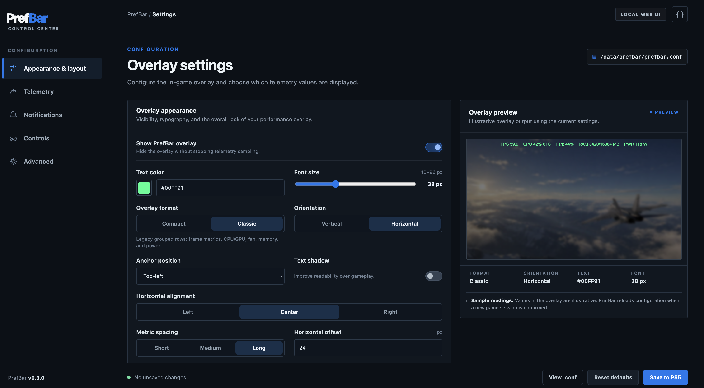

<p align="center">
  
</p>

[](https://github.com/X1NONs/PrefBar/releases)

[](https://github.com/X1NONs/PrefBar/releases)

**Version 0.3.1**
(**Active Development:** PrefBar ships almost weekly on weekends. New features, firmware fixes, and optimizations land constantly. Check the Releases tab to stay current)


A standalone on-screen performance overlay for jailbroken PlayStation 5 consoles. PrefBar displays live performance and system telemetry directly over your games.

**customize the overlay** with PrefBar's built in Web Control Center.

## Why This Exists

The built-in performance bars available in some PS5 homebrew setups can conflict with other kernel-level components or payloads, such as kstuff and etaHEN. PrefBar was created as an independent alternative: a standalone payload with its own ShellUI renderer, designed to provide in-game telemetry without depending on another payload for rendering.



> Want yours to get displayed? Check out [Screenshot Discussion](https://github.com/X1NONs/PrefBar/discussions/13).

## Features

- **Frame performance:** FPS, average frametime, and 1% lows.
- **CPU/GPU telemetry:** CPU utilization, CPU frequency, GPU clock, CPU temperature, and GPU temperature when the relevant system interfaces are available.
- **Fan telemetry:** Fan-duty percentage. This is not an RPM reading.
- **Memory:** RAM and VRAM usage when the relevant system interfaces are available.
- **SoC power:** APU power consumption displayed in watts when the relevant kernel API is available.
- **M.2 SSD temperature:** Monitor the NVMe expansion drive through SoC sensor channel 2, with an optional `M.2` / `SSD` label. The metric shows N/A when the channel is present but no valid drive reading is available.
- **Four-corner positioning:** Place vertical overlays at the top-left, top-right, bottom-left, or bottom-right of the screen. Horizontal overlays use their separate left/center/right alignment setting.
- **Horizontal overlay:** Display all enabled metrics in one horizontal bar, centered by default, with configurable left/center/right alignment and short, medium, or long spacing.
- **Independent telemetry controls:** Enable or disable FPS, frametime, 1% low, CPU usage/temperature/clock, GPU temperature/clock, fan duty, RAM, VRAM, SoC power, and M.2 temperature separately. The GPU label can be changed with `gpu_temp_label`; the M.2 label defaults to `m2` and can be changed to `ssd` with `m2_temp_label=ssd`.
- **Compact and classic metric formats:** Compact groups related metrics; classic preserves the previous one-metric-per-row layout. Disabled metrics are omitted, and an exposed M.2 sensor channel with no valid reading displays N/A.
- **Standalone payload:** The controller and ShellUI renderer are packaged into one combined ELF.
- **Customizable overlay:** Change text color and opacity, the shared black background and its independent opacity, font size, shadow, screen position, corner, layout, visibility, and which metric rows are displayed.
- **Automatic configuration reload:** Settings are reloaded when a new game session starts, without restarting PrefBar.
- **Quick toggle:** Triple-click the DualSense touchpad to show or hide the overlay. This can be disabled in the configuration.

## How to use it

1. Download `Prefbar_V0.3.1.elf` from [GitHub Releases](https://github.com/X1NONs/PrefBar/releases/tag/v0.3.1).
2. Load the payload ELF on your jailbroken PS5 using your usual payload loader.
3. Open the **PrefBar PS5 app** from the PS5 interface. It takes you straight to PrefBar's Control Center on the console, where you can customize the overlay, preview your changes, and save your settings.
4. Start a game. PrefBar waits for the game and ShellUI to be ready; allow a few seconds for initialization. The vertical layout normally appears at the top-left; horizontal mode is centered across the screen by default.
5. Triple-click the DualSense touchpad to toggle the overlay on or off. It is enabled by default.

PrefBar automatically registers its **PS5 app** entry after the Control Center starts; it may take a moment to appear. The app opens the Control Center provided by the already-running payload—it does not load PrefBar itself. The Control Center has no authentication, so keep the PS5 on a trusted network. If you built PrefBar with Web Control Center support disabled, use the manual configuration method below instead.

## Compatibility

PrefBar is designed to be a universal payload for jailbroken PS5 consoles. However, changes Sony makes to kernel APIs and ShellUI across firmware versions may affect its functionality, causing certain things to work differently or become unavailable on some firmware versions:

| Firmware       | Status                          |
| -------------- | ------------------------------- |
| **3.XX or below** | 🟡 Unverified or might not work
| **4.XX**       | ✅ Supported
| **5.XX**       | ✅ Supported
| **6.XX**       | ✅ Supported
| **7.XX**       | ✅ Supported
| **8.XX**       | ✅ Supported
| **9.XX**       | ✅ Supported
| **10.XX**      | ✅ Supported
| **11.XX**      | ✅ Supported
| **12.XX**      | ✅ Supported
| **13.XX**      | ✅ Supported

please [open an issue](https://github.com/X1NONs/PrefBar/issues) with your result so this table can be updated.

## Customization

### PS5 app (recommended)

The **PrefBar PS5 app** is the main way to customize PrefBar. After you load the PrefBar payload, it automatically registers a **PrefBar** app entry in the PS5 interface. Open PrefBar from the PS5 app to launch the built-in Control Center directly on your console. From there, adjust the overlay's appearance and layout, choose which telemetry metrics are shown, preview the result, and save your settings.

The PS5 app entry opens the Control Center served by the running PrefBar payload; it is not a separate payload or a way to load PrefBar. The combined payload must already be running.

### Web Control Center

You can also open the same Control Center from a browser on the same local network as your PS5 by visiting `http://<PS5-IP>:8998/`. This is a useful alternative when you prefer using another device or the PS5 app entry is unavailable. Adjust the overlay appearance and layout, choose which telemetry metrics are shown, and use the preview before saving.

The Save action writes the settings directly to the PS5. Changes are loaded when the next game session starts. The Control Center is included in the normal build; builds made with `PREFBAR_ENABLE_WEB=OFF` do not start the web server.

### Manual configuration

For builds without the Web Control Center, or when you prefer editing the settings file yourself, PrefBar stores its runtime settings at:

```text
/data/prefbar/prefbar.conf
```

You can edit this file with [PS5 Web File Manager](https://github.com/owendswang/ps5-web-file-manager) or any other file-management method. It supports overlay visibility, text color and opacity (text_opacity, from 0–100%), text shadow, font size, layout, screen position, horizontal alignment and spacing, compact/classic metric formats, and independent visibility switches for every telemetry metric, including M.2 temperature. Set `m2_temp_label=m2` (default) or `m2_temp_label=ssd` to change its display name. You can also configure SoC power monitoring, touchpad controls, notifications, and diagnostics.

Configuration changes are automatically reloaded when a new game session starts. This behavior has been available since v0.2.1.

### Metric format

`overlay_format=compact` is the default. It groups frame metrics, CPU metrics, GPU metrics, memory, and system readings into a small number of labeled rows. Set `overlay_format=classic` to restore the previous one-metric-per-row layout. Every `show_*` switch remains independent in both formats.

### Horizontal overlay

Set `overlay_horizontal=1` to display the metrics in one horizontal bar. The bar is centered by default; use `overlay_horizontal_align` to choose `left`, `center`, or `right`. Choose the gap between metrics with `overlay_horizontal_spacing`:

```ini
overlay_format=compact
overlay_horizontal=1
overlay_horizontal_align=center
overlay_horizontal_spacing=medium
```

Alignment accepts `left`, `center`, or `right`, and defaults to `center`. Spacing accepts `short`, `medium`, or `long`, and defaults to `medium`. PrefBar compacts enabled metrics, re-centers the resulting bar, and reduces the font size when necessary to fit the screen.

### Color recommendations

Set the `text_color` value to a six-digit hexadecimal color in `#RRGGBB` format. These are some good starting points:

| Color | Sample | Hex value |
|---|:---:|---|
| **Aqua recommended** |  | `#00E5FF` |
| Cyan |  | `#00FFFF` |
| Ice blue |  | `#8BE9FD` |
| Green |  | `#4ADE80` |
| Amber |  | `#FBBF24` |
| White default |  | `#F2F2F2` |

**Recommended starting point:**

```ini
text_color=#00E5FF
text_opacity=100
text_shadow=1
overlay_horizontal=1
overlay_horizontal_align=center
overlay_horizontal_spacing=medium
```

The shadow helps keep bright text readable over different game scenes. The color palette is only a set of suggestions; use whichever color is easiest to read in your game.

For the full `.conf` setting list, accepted values, and a complete example, see [HOW_IT_WORKS.md — Runtime configuration](Docs/HOW_IT_WORKS.md#runtime-configuration).

Existing configuration files are not overwritten. Changes are reloaded when a new game session starts.

## Discussions

Have screenshots, ideas for new features, or suggestions for PrefBar? Share them in [GitHub Discussions](https://github.com/X1NONs/PrefBar/discussions)!

## Build from source

Want to compile PrefBar yourself? See the [build guide](Docs/BUILD.md) for the PS5 Payload SDK requirements, build commands, output files, optional host tests, and cleanup instructions.

For architecture details, runtime behavior, and configuration internals, see [HOW_IT_WORKS.md](Docs/HOW_IT_WORKS.md).

## Support

PrefBar is free software under GPL-3.0 and will stay free. If it's useful to you, voluntary tips are appreciated, no strings attached.

| Network | Address |
|---|---|
| BTC | `bc1qse9aacl20l2kewxkr529nxvjrsnulz6x9vxf43` |
| ETH / USDC (ERC-20) | `0x5De60ca53aE6Dbd8C8B9a99a578519244D264ee0` |
| BNB (BEP-20) | `0x5De60ca53aE6Dbd8C8B9a99a578519244D264ee0` |
| SOL | `2qJYqm3pnX1jFtcG5zKtoh8KTuXE7iqqwNxCLFy2oFk3` |
| TRX (TRC-20) | `TC5BpBP4P8AcXqvYC7RtWyXfL6Xx1QR5ph` |

## Credits & license

**License:** GPL-3.0

For full credits, attribution, and source provenance, see [CREDITS.md](Docs/CREDITS.md).

**Disclaimer:** PrefBar is unofficial homebrew. Use it at your own risk.
