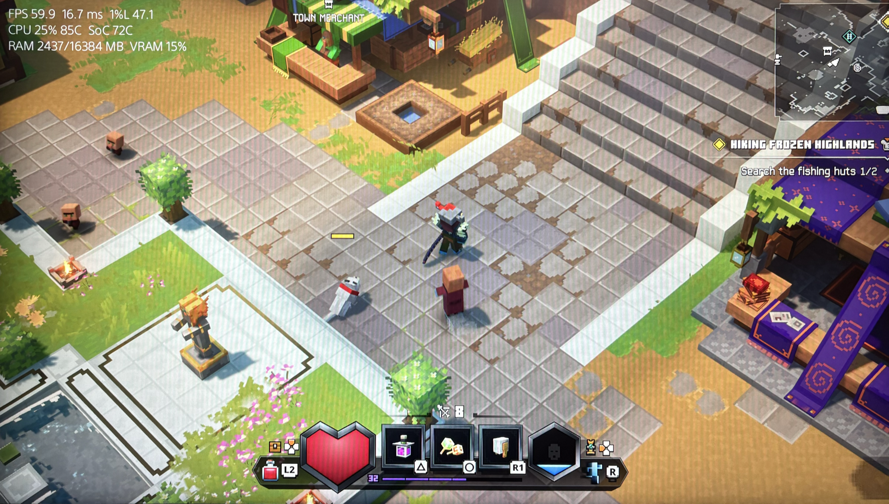

# PerfBar - On-Screen Performance Overlay for Jailbroken PS5

**Version 0.1.3**

A standalone on-screen performance overlay for the PS5. It draws FPS, frametimes, 1% lows, CPU/SoC temperatures,fan usage and RAM/VRAM usage directly over your games.

### Why this exists
If you've tried using the built-in performance bars in `etaHEN` alongside `kstuff`, you know they often fight over kernel control and cause instant kernel panics. 

**perfbar** was built to fix that. It is a completely standalone payload. It does not require any other payloads, and it does not fight with any other payload for kernel memory. You can run this alongside your normal setup without causing a System Software Error.

## ⚡ How to use it

1. Send the `PrefBar-complete_VX.X.X.elf` payload to your PS5.
2. Start a game.
3. After roughly 5–10 seconds, the overlay will appear in the top-left corner.
4. Triple-tap the DualSense touchpad to toggle the overlay on or off(on by default).

## 💎 Credits & License

**License:** GPL-3.0

This project is a fork of open-source work:
*   **FPS Source (`/dev/dce`):** `etaHEN` and `OnionHEN` (LightningMods, PHU Games Tools by ArkSama).
*   **ShellUI Renderer:** `erickdavestech` (ps5-dualsense-overlay) and the Common FPS team.

**Disclaimer:** This is unofficial homebrew. Use at your own risk.
