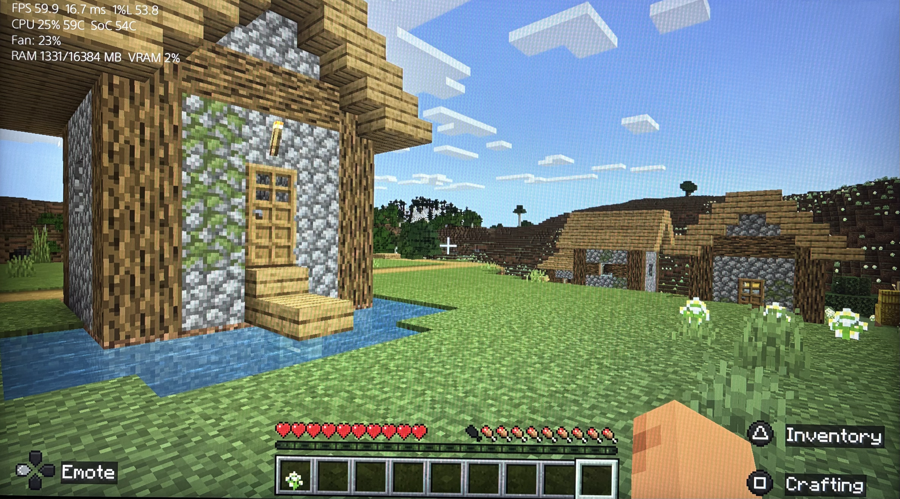

# PrefBar — PS5 Performance Overlay

[](https://github.com/X1NONs/PrefBar/releases)

**Version 0.2.0**

A standalone on-screen performance overlay for jailbroken PlayStation 5 consoles. PrefBar displays live performance and system telemetry directly over your games, without requiring a separate renderer payload.



## ⚡ Features

- **Frame performance:** FPS, average frametime, and 1% lows.
- **CPU and temperatures:** CPU utilization and temperature, plus SoC temperature when the relevant system interfaces are available.
- **Fan telemetry:** fan-duty percentage. This is not an RPM reading.
- **Memory:** RAM and VRAM usage when the relevant system interfaces are available.
- **Standalone payload:** the controller and ShellUI renderer are packaged into one combined ELF.
- **Customizable overlay:** change the text color, text size, shadow, screen position, corner, layout, visibility, and which metric rows are shown.
- **Quick toggle:** triple-click the DualSense touchpad to show or hide the overlay. This can be disabled in the configuration.

Metric availability depends on the PS5 firmware and runtime environment. An unavailable sensor is not the same as a reading of zero.

## 🎮 How to use it

1. Download `PrefBar-complete_V0.2.0.elf` from [GitHub Releases](https://github.com/X1NONs/PrefBar/releases).
2. Load the combined ELF on your jailbroken PS5 using your usual payload loader.
3. Start a game. PrefBar waits for the game and ShellUI to be ready; allow a few seconds for initialization. The overlay normally appears in the top-left corner.
4. Triple-click the DualSense touchpad to toggle the overlay on or off. It is enabled by default.

## 🎨 Customization and colors

PrefBar reads its runtime settings from:

```text
/data/prefbar/prefbar.conf
```

The configuration supports overlay visibility, text color, text shadow, font size, layout, screen position, and metric-row selection. You can also control the touchpad toggle and notification/diagnostic options.

### Color recommendations

Set the `text_color` value to a six-digit hexadecimal color in `#RRGGBB` format. These are some good starting points:

| Color | Sample | Hex value |
|---|:---:|---|
| **Aqua — recommended** |  | `#00E5FF` |
| Cyan |  | `#00FFFF` |
| Ice blue |  | `#8BE9FD` |
| Green |  | `#4ADE80` |
| Amber |  | `#FBBF24` |
| White — default |  | `#F2F2F2` |

**Recommended starting point:**

```ini
text_color=#00E5FF
text_shadow=1
```

The shadow helps keep bright text readable over different game scenes. The color palette is only a set of suggestions; use whichever color is easiest to read in your game.

For the full `.conf` setting list, accepted values, and a complete example, see [HOW_IT_WORKS.md — Runtime configuration](Docs/HOW_IT_WORKS.md#runtime-configuration). Existing configuration files are not overwritten, and changes take effect after restarting PrefBar.

## 🛠️ Build from source

Want to compile PrefBar yourself? See the [build guide](Docs/BUILD.md) for the PS5 Payload SDK requirements, build commands, output files, optional host tests, and cleanup instructions.

For architecture details, runtime behavior, and configuration internals, see [HOW_IT_WORKS.md](Docs/HOW_IT_WORKS.md).

## Compatibility

Firmware compatibility is version-dependent. Check the project releases and reports for firmware versions that have actually been tested. Sensor readings and some overlay features may vary with firmware and runtime support.

## 💎 Credits & license

**License:** GPL-3.0

For full credits, attribution, and source provenance, see [CREDITS.md](Docs/CREDITS.md).

**Disclaimer:** PrefBar is unofficial homebrew. Use it at your own risk.
